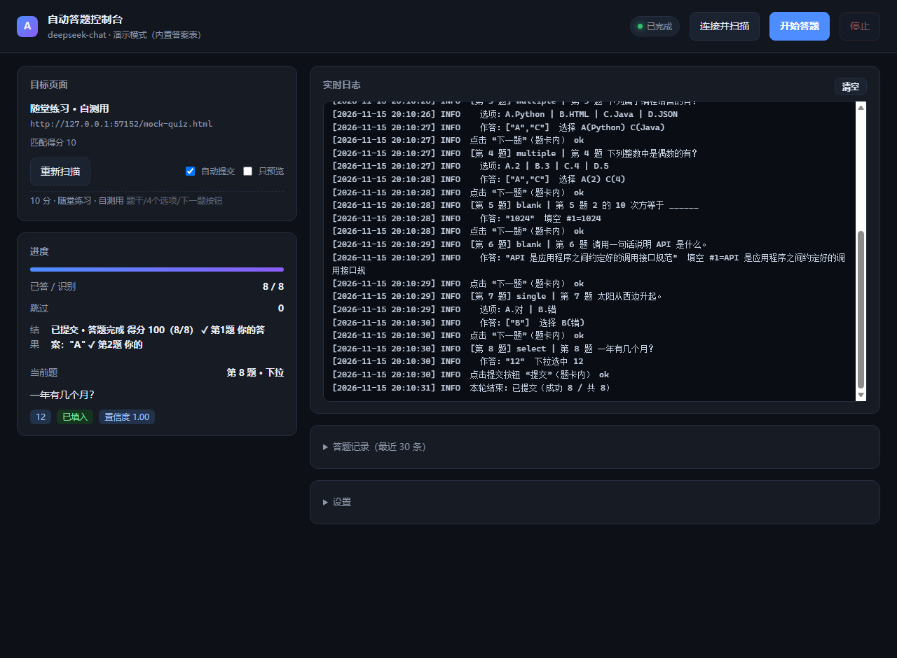

# browser-autoanswer

Automate answering quizzes in a **real, already-logged-in browser**. It finds the quiz tab over CDP,
reads each question from the DOM, asks an LLM for the answer, applies it (click / check / type /
select), then advances to the next question and submits.

No extension, no headless re-login, no site-specific build.



> ## ⚠️ Responsible use
>
> This project automates the act of answering questions. Use it **only where automation is allowed**:
> your own practice apps, internal training you own, QA/accessibility tooling, or test fixtures.
>
> **Do not** use it on proctored exams, graded assessments or certification tests. That is cheating
> and is often a disciplinary offence. The project also deliberately does **not** try to defeat
> proctoring signals (tab-switch counters, focus detection, etc.). Authors accept no liability for
> misuse.

## Features

| Area | What you get |
| --- | --- |
| Target tab | Scores every open tab and picks the one that looks like a quiz; waits for a tab that is still loading; re-acquires mid-run if the quiz moves |
| Question parsing | Single / multiple choice, true-false, text & textarea blanks, `<select>`, and custom `div` option lists |
| Answers | Any OpenAI-compatible endpoint (DeepSeek, OpenAI, Moonshot, local vLLM…), strict-JSON parsing with tolerant fallback |
| Applying answers | Clicks/checks/fills, then **reads back** `checked`/`value`; falls back to native setters + `input`/`change` events for React/Vue |
| Auto-advance | Button → question sidebar → URL paging → keyboard → scroll (single-page quizzes) → submit |
| Scope guard | Page chrome (`header`, `nav`, language switchers, toolbars) is never clicked and never parsed as options |
| Observability | JSONL per-question log, optional screenshots, dry-run mode, confidence threshold |
| Interfaces | Small local web panel (`panel.cmd` / `npm run panel`) and a CLI |

## Requirements

- Node.js **18+**
- A Chromium-based browser (Edge or Chrome) — telemetry-free: the tool only drives what you have open
- An API key for an OpenAI-compatible chat endpoint

## Install

```bash
git clone https://github.com/OWNER/browser-autoanswer.git
cd browser-autoanswer
npm install                     # installs playwright-core only, no browser download
cp config.example.json config.json
export DEEPSEEK_API_KEY=sk-...  # or edit llm.apiKey in config.json
```

Windows users can run the helper scripts (`setup.cmd`, `run.cmd`, `panel.cmd`). They look for Node in
this order, so Node does **not** have to be on `PATH`:

1. `AA_NODE` environment variable (full path to `node.exe`)
2. a `node.path` file next to the scripts, containing the full path on one line (git-ignored)
3. `runtime\node.exe` — a portable Node build dropped next to the scripts
4. `node` on `PATH`

## Usage

### Control panel (recommended)

```bash
npm run panel        # Windows: double-click panel.cmd
```

It starts a local server on `http://127.0.0.1:3210/` and opens it. In the panel:

1. **设置** → paste API key / model (or rely on the env var) → save.
2. Open the quiz in your browser and log in.
3. **连接并扫描** → it attaches to that tab.
4. **只预览** first if you want to see the answers without touching the page.
5. **开始答题**.

> The panel UI is currently Chinese-only. PRs for i18n are welcome.

### CLI

```bash
node src/main.js --dry-run     # read + answer, never click or fill
node src/main.js               # run for real
node src/main.js --url "https://example.com/quiz?page=1"   # pin a specific page
```

`--url` is optional: without it the tool scans tabs and picks the quiz itself.

## How it works

```
browser (your session)  <--CDP-->  agent
                                   ├─ detect.js   score every tab, pick the quiz
                                   ├─ extract.js  question text + options + inputs
                                   ├─ solver.js   prompt -> LLM -> strict JSON
                                   ├─ act.js      apply answer, verify it stuck
                                   └─ agent.js    loop: read -> answer -> advance
```

Answer application is verified: after clicking an option the tool re-reads its state, and if the
site's custom widget ignored the click it dispatches native `input`/`change` events as a fallback.

## Picking the right tab

Every open tab is scored:

| Signal | Score |
| --- | --- |
| question text (≥4 chars) | +4 |
| ≥2 options | +3 |
| blank inputs | +2 |
| next/submit button | +2 |
| recognised question kind | +1 |
| already a result page | −5 |
| options are all language names, or title looks like a language picker | −8 / −6 |

The highest score above 3 wins; the rest are logged as candidates.

## Advancing to the next question

| Order | Strategy | When it applies |
| --- | --- | --- |
| 1 | Button | "Next / 下一题 / 继续" |
| 2 | Question sidebar | a numbered question list |
| 3 | URL paging | `?page=2`, `#3`, `/4/` — only page-like params are touched |
| 4 | Keyboard | `Enter`, `→`, `PageDown` |
| 5 | Scroll | single-page quizzes: scrolls the next question into view |
| 6 | Submit | nothing left to advance to |

Each strategy must **prove** the question changed before it counts. When a submit button is already
visible, only the non-destructive strategies (sidebar/scroll) are used, so a stray URL bump or
`Enter` cannot hand in a half-finished paper.

## Staying inside the question area

- Buttons inside `header`, `nav`, `footer`, `aside`, `[role=navigation]` and anything whose class/id
  contains `lang`, `locale`, `i18n`, `switch`, `toolbar`, `breadcrumb`, `topbar`, `tabbar` are ignored.
- Buttons whose text is a language name (`English`, `中文`, `日本語`…) are ignored even outside chrome.
- "Next"/"Submit" prefer the element inside the question block; the log marks it with `（题卡内）`.
- Wrapper elements that contain other buttons are never treated as buttons.
- Option lists drop language switchers and outer containers — only the innermost options remain.
- URL paging never touches `lang`, `locale`, `v`, `t`, `id` and friends.

## Configuration

`config.json` is merged over the defaults in `src/config.js`.

| Key | Meaning |
| --- | --- |
| `browser.mode` | `cdp` (attach) or `launch` (start our own) |
| `browser.cdpEndpoint` | default `http://127.0.0.1:9222` |
| `browser.autoLaunch` | start a debuggable browser when nothing is listening |
| `browser.autoDetect` / `detectTimeoutMs` | tab auto-detection and how long to wait |
| `llm.baseURL` / `llm.model` / `llm.apiKeyEnv` | OpenAI-compatible endpoint, model, key source |
| `agent.dryRun` | answer without touching the page |
| `agent.autoSubmit` | click submit automatically |
| `agent.delayMs` | pause between questions |
| `agent.nextStrategies` / `nextKeys` | auto-advance order and keys |
| `agent.ignoreTextRegex` | extra button texts to ignore |
| `selectors.*` | question / blank / option / next / submit / result selectors |
| `selectors.chrome` | regions treated as page chrome |

## Adapting to a new site

```bash
node tools/inspect.js --shot runs/shot.png
```

It prints the detected kind, question text, option keys, blanks, selects, buttons and result area,
and saves a screenshot. If something is off, adjust `selectors.*` (or `selectors.chrome`) and re-run.

## Tests

```bash
npm test          # unit tests: answer normalisation, prompt building, config merge (no browser)
npm run test:e2e  # end-to-end: local mock quiz pages + a stub LLM server (needs Edge/Chrome)
```

The e2e suite covers: 8-question run to 100 points, dry-run, tab detection against a login page,
four auto-advance modes, decoy language/`Next` buttons in the page chrome, and a replica of a
judge-question page with an embedded language switcher.

## Project layout

```
src/        core: detect / extract / solver / act / nav / agent / browser / config / llm
app/        local control panel (server.js, controller.js, ui.html)
tools/      inspect.js (page diagnostics), screenshot-panel.js
test/       mock quiz pages, fixtures, unit + e2e tests
config.example.json
```

## Troubleshooting

- **`[x] node.exe not found`** — the wrappers cannot find Node. Install Node.js 18+, or set `AA_NODE`
  to the full path of `node.exe`, or write that path into a `node.path` file, or put a portable
  `node.exe` into `runtime\`.
- **`connectOverCDP` fails** — start the browser with `--remote-debugging-port=9222`, or let
  `browser.autoLaunch` do it.
- **Clicked but nothing selected** — many sites use controlled components; check the `applied` field
  in `runs/answers.jsonl`. If it is `false`, the site's option markup needs a selector tweak.
- **Wrong element clicked** — look for `（题卡内）` in the log; if it is missing the element is outside
  the question block, so add its container to `selectors.chrome`.
- **Questions inside an iframe** — only the main document is handled today.
- **Canvas-rendered quizzes** — no DOM text; `llm.visionModel` can only produce advice, not clicks.

## License

MIT — see [LICENSE](LICENSE).

中文说明：[README.zh-CN.md](README.zh-CN.md)
=======
# browser-ai-answer-tool
此脚本用于对浏览器中的题目进行ai自动答题，可通过某些school的无意义考试
>>>>>>> c148ca77f760c68e05d11fcce6e24a2479ef9219
