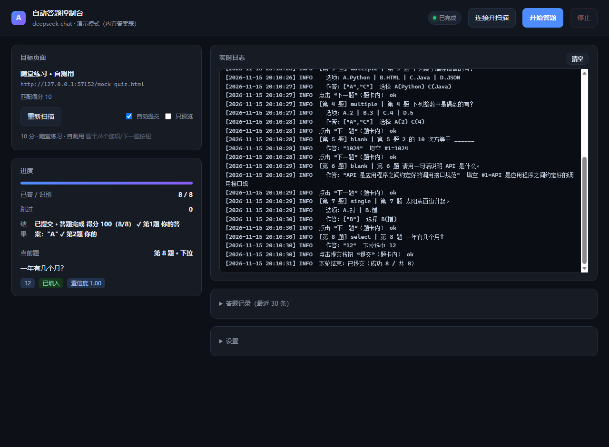

# browser-autoanswer

在**真实、已登录的浏览器**里自动答题：CDP 接管标签页 → 读题 → 让大模型出答案 → 点击/勾选/填写 →
自动跳到下一题 → 交卷。不用装扩展，不用重新登录，也不绑定具体站点。



> ## ⚠️ 使用边界
>
> 本项目自动化的是"答题"这个动作。请在**被允许自动化**的场景使用：自己的练习应用、公司的内部培训、
> QA/无障碍测试、测试用的模拟页面。
>
> **不要**用于监考考试、计分考核、认证考试——那属于作弊，通常也会被认定为违纪。项目也**刻意不做**
> 任何规避监考的技术（切屏计数、焦点检测等）。作者不对误用承担责任。

## 功能

| 模块 | 说明 |
| --- | --- |
| 选对标签页 | 给每个标签页打分，挑出最像考题的那个；题目还没打开会等待；答题途中跳页会自动重新识别 |
| 读题 | 单选 / 多选 / 判断 / 文本与多行填空 / 下拉 / 自定义 div 选项 |
| 出答案 | 任意 OpenAI 兼容接口（DeepSeek、OpenAI、Moonshot、本地 vLLM…），严格 JSON + 容错解析 |
| 落答案 | 点击/勾选/填写后**回读校验**；不生效就用原生 setter + `input`/`change` 事件兜底（React/Vue 受控组件） |
| 自动跳题 | 按钮 → 题号侧栏 → URL 翻页 → 键盘 → 滚动（一页多题）→ 提交 |
| 只碰题目 | 页头、导航、语言切换、工具栏一律不点，也不当作选项 |
| 可观测 | 逐题 JSONL 记录、可选截图、dry-run、置信度阈值 |
| 入口 | 本地网页面板 + 命令行 |

## 环境要求

- Node.js **18+**
- Chromium 内核浏览器（Edge / Chrome）
- 一个 OpenAI 兼容接口的 API Key

## 安装

```bash
git clone https://github.com/OWNER/browser-autoanswer.git
cd browser-autoanswer
npm install                      # 只装 playwright-core，不下载浏览器
cp config.example.json config.json
export DEEPSEEK_API_KEY=sk-...   # 或者直接改 config.json 里的 llm.apiKey
```

Windows 上可以直接双击 `setup.cmd` 装依赖；`run.cmd` / `panel.cmd` 是包装脚本。

### Windows：node 不在 PATH 里？

三个脚本按这个顺序找 Node，所以**不要求** `node` 在 PATH 里：

1. 环境变量 `AA_NODE`（写 `node.exe` 的完整路径）
2. 脚本同目录下的 `node.path` 文件，里面一行写完整路径（已 gitignore）
3. `runtime\node.exe`（放一个便携版 Node）
4. PATH 里的 `node`

最省事的做法是 `echo C:\path\to\node.exe > node.path`，或者直接把便携版放进 `runtime\`。

## 用法

### 网页面板（推荐）

```bash
npm run panel          # Windows：双击 panel.cmd
```

服务起在 `http://127.0.0.1:3210/` 并自动打开。在面板里：

1. 「设置」填 API Key / 模型 → 保存（也可以只用环境变量）
2. 浏览器里打开题目页并登录
3. 点「连接并扫描」，自动接管该标签页
4. 想先看看答案就勾「只预览」
5. 点「开始答题」

### 命令行

```bash
node src/main.js --dry-run     # 只读题、出答案，不点不填
node src/main.js               # 正式跑
node src/main.js --url "https://example.com/quiz"   # 指定页面
```

`--url` 是可选的：不传就自动扫描标签页找题目。

## 它是怎么找到题目的

每个标签页按特征打分：

| 特征 | 加分 |
| --- | --- |
| 有题干（≥4 字） | +4 |
| 有 ≥2 个选项 | +3 |
| 有填空 | +2 |
| 有"下一题"或"提交"按钮 | +2 |
| 识别出题型 | +1 |
| 已经是结果页 | −5 |
| 选项全是语言名 / 题干像语言设置 | −8 / −6 |

最高分且 ≥3 分的页面被接管，其余页面记进日志的"候选"。

## 自动跳到下一题

| 顺序 | 方式 | 场景 |
| --- | --- | --- |
| 1 | 按钮 | 有"下一题 / 继续 / Next" |
| 2 | 题号侧栏 | 左侧题目列表，点"第 N 题" |
| 3 | URL 翻页 | `?page=2`、`#3`、`/4/`，只动页码类参数 |
| 4 | 键盘 | `Enter` / `→` / `PageDown` |
| 5 | 滚动 | 一页多题，滚到下一题 |
| 6 | 提交 | 没有下一题时交卷 |

每种方式都要**确认题干真的变了**才算成功。页面上已经出现提交按钮时，只用不会误交卷的方式
（题号侧栏 / 滚动），避免 `Enter` 或改 URL 把没做完的卷子交掉。

## 只对题目区域操作

- `header`、`nav`、`footer`、`aside`、`[role=navigation]`，以及 class/id 含 `lang`、`locale`、
  `i18n`、`switch`、`toolbar`、`breadcrumb`、`topbar`、`tabbar` 的元素一律不点。
- 文案是语言名的按钮（`English`、`中文`、`日本語`…）即使在题目区域里也不点。
- "下一题/提交"优先取题干区块内的那个，日志里会标 `（题卡内）`。
- 内部还包着别的按钮的容器，不会被当成按钮。
- 选项里会剔除语言切换和"包住其它选项"的外层容器，只留最内层。
- URL 翻页绝不修改 `lang`、`locale`、`v`、`t`、`id` 这类参数。

## 配置

`config.json` 会覆盖 `src/config.js` 里的默认值。

| 键 | 说明 |
| --- | --- |
| `browser.mode` | `cdp`（接管已有浏览器）或 `launch`（自己起一个） |
| `browser.cdpEndpoint` | 默认 `http://127.0.0.1:9222` |
| `browser.autoLaunch` | 连不上时自动拉起带调试端口的浏览器 |
| `browser.autoDetect` / `detectTimeoutMs` | 自动识别标签页与其等待时长 |
| `llm.baseURL` / `llm.model` / `llm.apiKeyEnv` | 接口地址、模型、Key 的环境变量名 |
| `agent.dryRun` | 只出答案，不动页面 |
| `agent.autoSubmit` | 是否自动交卷 |
| `agent.delayMs` | 每题之间的缓冲 |
| `agent.nextStrategies` / `nextKeys` | 自动跳题的顺序与按键 |
| `agent.ignoreTextRegex` | 额外忽略的按钮文案 |
| `selectors.*` | 题干、填空、选项、下一题、提交、结果区选择器 |
| `selectors.chrome` | 视为"页面外壳"的区域 |

## 适配新站点

```bash
node tools/inspect.js --shot runs/shot.png
```

它会打印题型、题干、每个选项的 key、填空/下拉、按钮定位，并截图。识别不对就改 `selectors.*`
（或 `selectors.chrome`）再跑。

## 测试

```bash
npm test          # 单元测试：答案归一化、提示词、配置合并（不需要浏览器）
npm run test:e2e  # 端到端：本地模拟题库 + 假模型接口（需要 Edge/Chrome）
```

端到端覆盖：8 题满分、dry-run、登录页干扰下的标签页识别、四种跳题方式、页头语言切换/`Next`
陷阱按钮、以及复刻"判断题 + 内嵌语言切换"的页面。

## 目录结构

```
src/        内核：detect / extract / solver / act / nav / agent / browser / config / llm
app/        本地控制面板（server.js、controller.js、ui.html）
tools/      inspect.js（页面体检）、screenshot-panel.js
test/       模拟题库、夹具、单元测试与端到端测试
config.example.json
```

## 常见问题

- **`[x] node.exe not found`** —— 脚本没找到 Node：装 Node.js 18+，或用 `AA_NODE`、`node.path`、
  `runtime\node.exe` 指过去（见上面「node 不在 PATH 里」）。
- **连不上 CDP** —— 浏览器没带 `--remote-debugging-port=9222`；或把 `browser.autoLaunch` 设为 true。
- **点了没选上** —— 受控组件站点；看 `runs/answers.jsonl` 里的 `applied` 字段，`false` 就需要针对该站点补选择器。
- **点错了元素** —— 看日志有没有 `（题卡内）`；没有说明它被判定在题目区块外，把它的容器加进 `selectors.chrome`。
- **题目在 iframe 里** —— 目前只处理主文档。
- **Canvas 渲染的题目** —— DOM 里没有文字，`llm.visionModel` 只能给建议，不会自动点击。

## 许可证

MIT，见 [LICENSE](LICENSE)。

English: [README.md](README.md)
